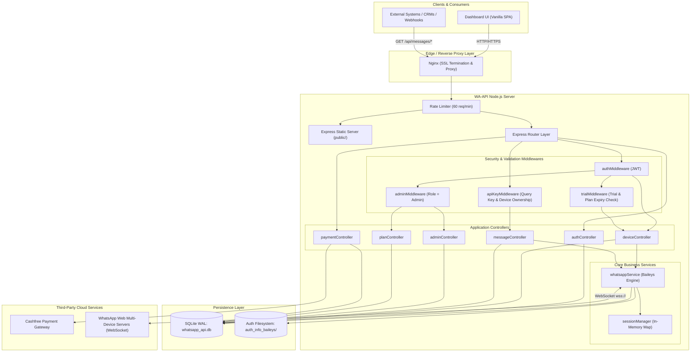
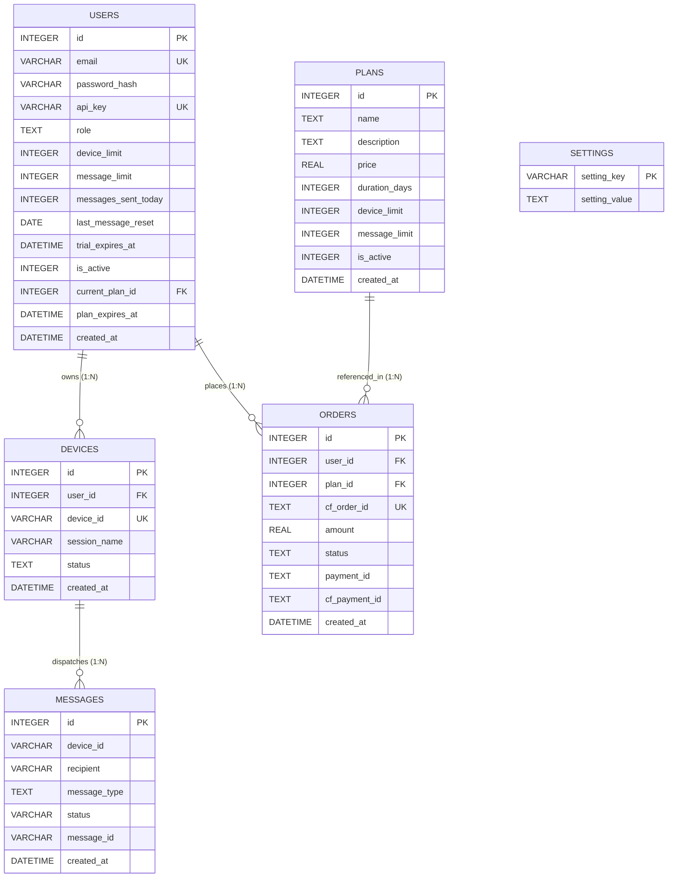
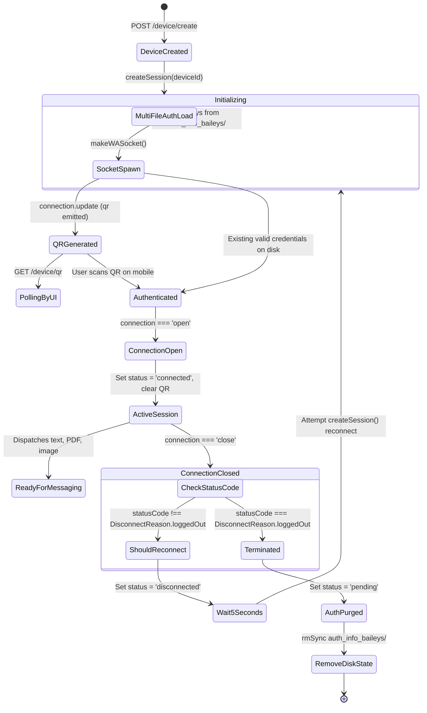
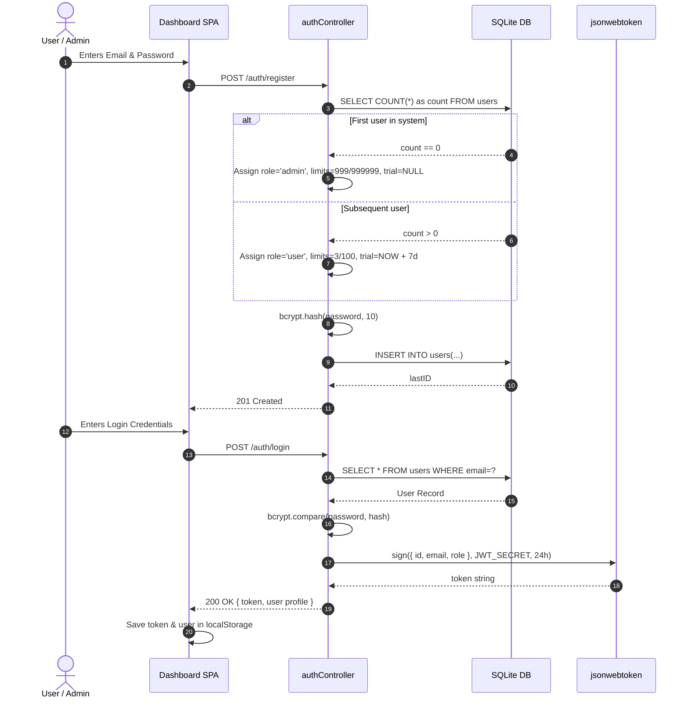
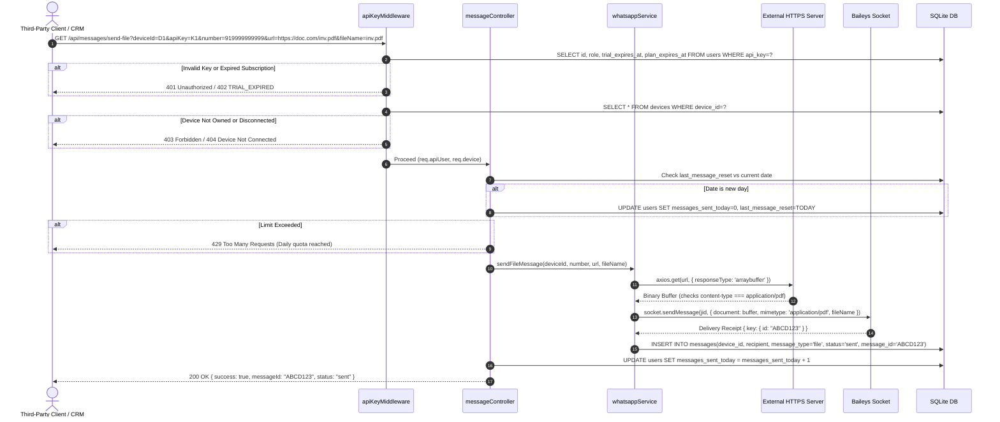
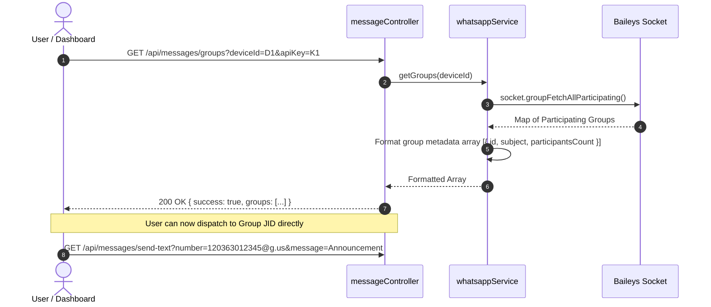
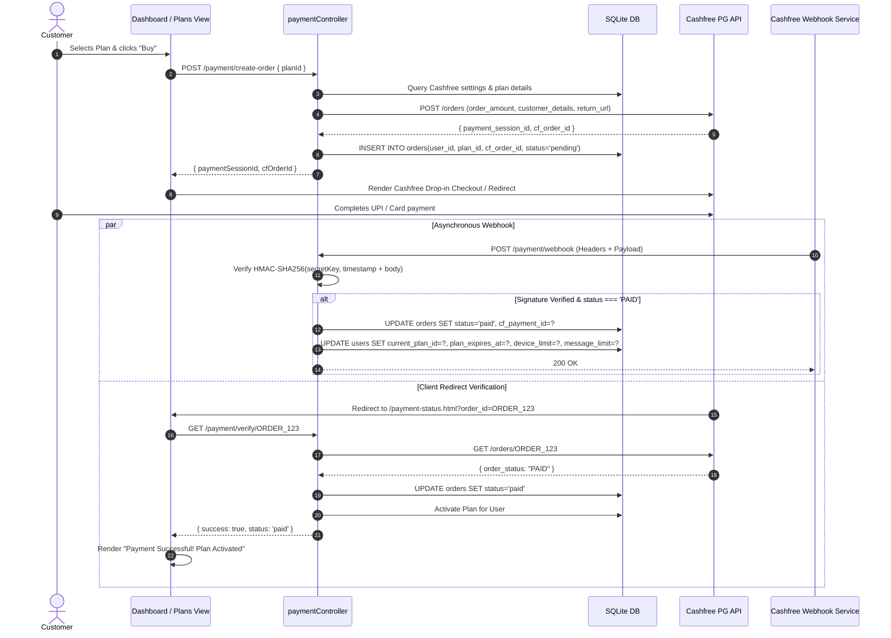
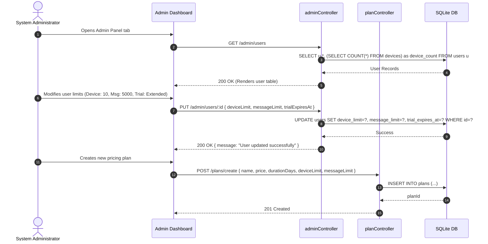
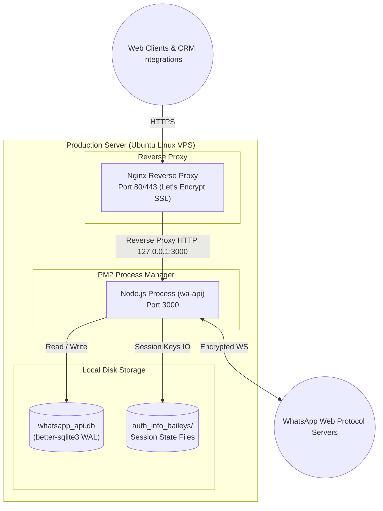

# 📄 Product Requirements Document (PRD) & System Architecture: WhatsApp Multi-Session API (WA-API)

---

## 1. Executive Summary & Product Vision

### 1.1 Overview
**WA-API** is a high-performance, self-hosted WhatsApp Multi-Session gateway and management dashboard. Built on **Node.js (Express 5)**, **@whiskeysockets/baileys (v7.0.0-rc.9)**, and **better-sqlite3**, it bridges standard web and backend applications with the WhatsApp Web Multi-Device protocol. 

The platform turns individual WhatsApp accounts into programmatic communication endpoints capable of transmitting text, PDF documents, and images, as well as fetching group rosters through URL query-string-based legacy GET endpoints.

### 1.2 Core Value Propositions
- **Zero Third-Party Cloud Dependency**: Runs entirely on self-managed infrastructure (bare-metal VPS, Linux/PM2, Docker, or systemd).
- **Multi-Tenant & Multi-Device Isolation**: Individual users can link multiple WhatsApp numbers, each with isolated cryptographic state keys on disk and independent memory sockets.
- **Legacy GET Integration**: Designed for effortless legacy system integration (CRMs, ERPs, webhooks, IoT devices, accounting software) where full JSON POST capabilities might be restricted.
- **Role-Based Monetization & Limits**: Built-in 7-day trials, daily quotas, plan tiers, admin controls, and Cashfree payment integration.

---

## 2. Product Requirements Document (PRD)

### 2.1 Target Personas
1. **Developers & Integrators**: Need a drop-in API to dispatch OTPs, transaction receipts, invoices, and alerts via WhatsApp without enterprise BSP fees.
2. **Small-to-Medium Businesses (SMBs)**: Need multiple support numbers managed from a central dashboard with automated renewal and quota limits.
3. **Platform Administrators**: Need a single dashboard to manage accounts, adjust device quotas, inspect message volumes, configure gateway keys, and oversee subscription plans.

### 2.2 Functional Requirements

#### FR-1: Account & Authentication Management
- **FR-1.1 Registration**: First user to register in the system is automatically designated as `admin` with unlimited devices (`999`) and daily messages (`999,999`). Subsequent users are assigned the `user` role with a default 7-day trial, 3 devices, and 100 messages/day.
- **FR-1.2 Passwords & Tokens**: Passwords hashed with `bcrypt` (10 salt rounds). Authentication issues JWT tokens valid for 24 hours.
- **FR-1.3 API Key Generation**: Users can generate and rotate a 32-character hexadecimal API key (`crypto.randomBytes(16)`) for accessing programmatic message routes.
- **FR-1.4 Profile Inspection**: Authenticated route `/auth/me` returns current user limits, active plan details, and trial expiration dates.

#### FR-2: WhatsApp Device & Session Management
- **FR-2.1 Device Provisioning**: Users register devices using their phone number as `deviceId` and an optional friendly `sessionName`.
- **FR-2.2 Pairing via QR Code**: Real-time QR generation converted to base64 Data URLs. Dashboard polls the QR endpoint every 3 seconds until paired.
- **FR-2.3 Connection State Tracking**: Automatic transition between `pending`, `connected`, and `disconnected`.
- **FR-2.4 Auto-Reconnection & Crash Recovery**: On application start, the server scans the database for connected devices and automatically re-initiates Baileys sockets with existing credential caches. In case of unexpected disconnects (network drops), auto-reconnection triggers with a 5-second backoff.
- **FR-2.5 Teardown & Purge**: Deleting a device terminates the active WebSocket, evicts memory structures, purges session credentials (`auth_info_baileys/<deviceId>`), and deletes associated message audit records.
- **FR-2.6 Profile Photo Sync**: Retrieves the connected device's WhatsApp profile picture URL via Baileys JID querying.

#### FR-3: Outbound Messaging Engine
- **FR-3.1 Text Messaging**: Sends plain-text messages to individual contacts or group JIDs (`@g.us`).
- **FR-3.2 PDF Dispatch**: Downloads documents from HTTPS URLs (up to 15 MB), verifies MIME type (`application/pdf`), and delivers as a WhatsApp native document.
- **FR-3.3 Image Dispatch**: Downloads images from HTTPS URLs (up to 15 MB), verifies MIME type (`image/*`), and delivers with optional captions.
- **FR-3.4 Group Discovery**: Fetches all participating WhatsApp groups (ID, name/subject, participant counts) for bulk messaging or routing.
- **FR-3.5 Daily Quota Enforcement**: Atomic increment and automatic midnight reset of `messages_sent_today`. Rejects transmissions when quota is exceeded (`429 Too Many Requests`).

#### FR-4: Subscription, Plans & Monetization
- **FR-4.1 Plan Tiers**: Configurable subscription packages (Price, Validity Days, Device Limit, Daily Message Limit, Active flag).
- **FR-4.2 Trial Protection**: Mid-flight validation intercepting requests when trial has expired and no paid plan exists (`402 TRIAL_EXPIRED`).
- **FR-4.3 Payment Gateway**: Cashfree payment integration for automated invoice generation, webhooks, signature verification, and plan activation.
- **FR-4.4 Offline Contact Fallback**: In-app modal with direct WhatsApp and phone links to contact the administrator for manual renewals.

#### FR-5: Administration & Governance
- **FR-5.1 User Management**: View all users, edit limits, manually reset daily message counters, toggle user status (`active`/`disabled`), and adjust trial expiration dates.
- **FR-5.2 Gateway Settings**: Dynamically update Cashfree credentials (App ID, Secret Key, Environment) stored in the database `settings` table without restarting the Node.js server.
- **FR-5.3 Plan Management**: Create, update, toggle visibility, and soft-delete subscription plans.

### 2.3 Non-Functional Requirements
- **NFR-1 Security**: 
  - JWT Bearer auth on all user management and device APIs.
  - API Key and device ownership validation on all outbound message endpoints.
  - Express rate limiting (`express-rate-limit` capped at 60 req/min per IP).
  - Webhook HMAC SHA-256 signature verification.
- **NFR-2 Performance & Concurrency**: 
  - SQLite running in **WAL (Write-Ahead Logging)** mode with foreign keys enabled.
  - In-memory Baileys socket caches (`Map`) for $O(1)$ lookups.
  - Multi-file auth state caching to avoid redundant disk I/O during crypto handshakes.
- **NFR-3 Reliability**: 
  - Graceful crash recovery with persisted WhatsApp cryptographic keys.
  - Automatic reconnection backoff loops.

---

## 3. System Architecture & Diagrams

### 3.1 High-Level Architecture Diagram
The following diagram illustrates the interaction between external clients, reverse proxies, Express application layers, service workers, SQLite storage, and the external WhatsApp infrastructure.



---

### 3.2 Database Schema & Entity-Relationship (ER) Diagram
The persistence layer is managed by `better-sqlite3` with strict relational constraints and WAL journaling.



---

### 3.3 Baileys Session Lifecycle & State Machine
Each device maintains an active lifecycle spanning socket allocation, handshake negotiation, QR generation, credential storage, and automatic reconnects.



---

## 4. In-Depth Feature Workings & Sequence Workflows

---

### 4.1 Feature 1: User Registration, Login & Role Attribution
When a new user registers:
1. `authController.register` queries `SELECT COUNT(*) FROM users`.
2. If `count === 0`, the user is promoted to `admin` with `device_limit: 999`, `message_limit: 999999`, and `trial_expires_at: NULL`.
3. If `count > 0`, the user is granted the `user` role with `device_limit: 3`, `message_limit: 100`, and `trial_expires_at: NOW + 7 days`.
4. Password is encrypted using `bcrypt` and stored.
5. On `/auth/login`, credentials are authenticated, and a signed JWT containing `{ id, email, role }` is generated.



---

### 4.2 Feature 2: Device Pairing, QR Polling & Startup Restoration
1. User requests device creation with `deviceId` (phone number) and an optional `sessionName`.
2. `deviceController.createDevice` verifies device quota and ensures no duplicate `deviceId` exists.
3. Database inserts record with status `pending`.
4. `whatsappService.createSession` creates directory `auth_info_baileys/<deviceId>`, initializes `useMultiFileAuthState`, and invokes Baileys `makeWASocket`.
5. Baileys fires `connection.update` containing a raw QR string.
6. The service converts raw QR into a base64 PNG data URL using `qrcode.toDataURL()` and stores it in `sessionManager.setQR(deviceId, qrDataUrl)`.
7. Dashboard UI displays a modal and polls `GET /device/qr?deviceId=xxx` every 3 seconds.
8. Once scanned, `connection === 'open'`, status becomes `connected`, the QR is cleared, and database status is updated.

```mermaid
sequenceDiagram
    autonumber
    actor User as End User
    participant UI as Dashboard UI
    participant DC as deviceController
    participant WS as whatsappService
    participant SM as sessionManager
    participant Bail as Baileys WASocket
    participant DB as SQLite DB

    User->>UI: Click "+ Add Device" (deviceId: 919876543210)
    UI->>DC: POST /device/create
    DC->>DB: Check user.device_limit vs current device count
    DC->>DB: INSERT INTO devices (status='pending')
    DC->>WS: createSession(deviceId)
    WS->>Bail: makeWASocket(auth: multiFileAuthState)
    WS->>SM: setSession(deviceId, socket)
    DC-->>UI: 201 Created (auto-opens QR modal)

    Bail->>WS: socket.ev.on('connection.update', { qr })
    WS->>WS: qrcode.toDataURL(qr) -> base64
    WS->>SM: setQR(deviceId, qrBase64)

    loop Every 3 seconds polling
        UI->>DC: GET /device/qr?deviceId=xxx
        DC->>SM: getQR(deviceId)
        SM-->>DC: qrBase64 Data URL
        DC-->>UI: { success: true, qr: "data:image/png;base64,..." }
        UI->>UI: Render  QR code
    end

    User->>Bail: Scans QR code using WhatsApp Mobile App
    Bail->>WS: socket.ev.on('connection.update', { connection: 'open' })
    WS->>SM: clearQR(deviceId)
    WS->>DB: UPDATE devices SET status='connected' WHERE device_id=?

    UI->>DC: GET /device/qr?deviceId=xxx
    DC-->>UI: { success: true, status: 'connected', qr: null }
    UI->>UI: Stop Polling, show "Device Connected ✅", reload list
```

---

### 4.3 Feature 3: Legacy GET Messaging Engine & Quota Protection
Message endpoints accept requests via HTTP `GET` with URL query parameters for straightforward integration into legacy software.

#### Pipeline Stages:
1. **API Key Middleware (`apiKeyMiddleware`)**:
   - Extracts `apiKey` and `deviceId` from query string.
   - Verifies key exists and fetches owning user.
   - Evaluates trial and plan expiry: if `role !== 'admin'`, checks if `trial_expires_at < NOW` and user lacks an active paid plan. If expired, halts with `402 TRIAL_EXPIRED`.
   - Validates that `device.user_id === user.id`.
   - Confirms `device.status === 'connected'`.
2. **Quota Check (`checkAndResetDailyCounter`)**:
   - Compares user's `last_message_reset` with current UTC calendar date (`YYYY-MM-DD`).
   - If day has changed, resets `messages_sent_today = 0` and updates `last_message_reset`.
   - If `messages_sent_today >= message_limit` (and `role !== 'admin'`), aborts with `429 Daily message limit reached`.
3. **Payload Processing & Delivery**:
   - **Text**: Resolves recipient JID via `formatJID(number)`. Invokes `socket.sendMessage(jid, { text })`.
   - **File (PDF)**: Verifies URL begins with `https://`. Downloads file using `axios` with an arraybuffer stream (capped at 15 MB). Inspects response `content-type` for `application/pdf`. Sends via Baileys document message payload.
   - **Image**: Verifies `https://`. Downloads and checks `content-type` starts with `image/`. Sends via Baileys image message with caption.
4. **Counter & Audit Trail**:
   - On dispatch success, writes record to `messages` table and increments `users.messages_sent_today`.



---

### 4.4 Feature 4: WhatsApp Group Extraction & Group Messaging
1. The endpoint `GET /api/messages/groups?deviceId=xxx&apiKey=yyy` accesses the active Baileys socket.
2. Calls `socket.groupFetchAllParticipating()`.
3. Maps participating group metadata: Group JID (`120363xxx@g.us`), subject name, owner, and participant count.
4. Returned group IDs can be passed directly as the `number` query parameter in `send-text`, `send-file`, and `send-image` endpoints.



---

### 4.5 Feature 5: Subscription Billing & Cashfree Payment Architecture
The platform includes a Cashfree payment gateway integration with offline fallbacks.

1. **Order Creation (`POST /payment/create-order`)**:
   - User chooses an active plan (`plans` table).
   - Server reads Cashfree credentials dynamically from `settings` table (or fallback `.env`).
   - Requests order generation at Cashfree (`https://api.cashfree.com/pg/orders` or sandbox).
   - Generates and stores `orders` record in SQLite with status `pending`.
   - Returns Cashfree `payment_session_id`.
2. **Webhook Verification (`POST /payment/webhook`)**:
   - Cashfree sends webhook callback on payment completion.
   - Controller verifies HMAC SHA-256 signature using `x-cashfree-timestamp` and `x-cashfree-signature`.
   - On verified `PAID` status, calls `activatePlan(userId, planId)`.
3. **Plan Activation**:
   - Calculates expiration date: `NOW + plan.duration_days`.
   - Updates `users` table: updates `current_plan_id`, sets `plan_expires_at`, sets `device_limit`, sets `message_limit`, and resets `trial_expires_at = NULL`.
4. **Fallback Polling**:
   - User browser redirects to `public/payment-status.html?order_id=xxx`.
   - Direct verification endpoint `/payment/verify/:orderId` confirms state with Cashfree servers if webhooks are delayed.
5. **Offline Fallback**:
   - The UI includes a modal linking directly to admin WhatsApp (`wa.me/919603761820`) and phone calls.



---

### 4.6 Feature 6: Administration & Operational Governance
Administrators enjoy unrestricted operational controls:
- **Exemptions**: Admins have no device caps, no daily message caps, and bypass trial/plan expiry checks.
- **User Oversight**: View total devices, daily messages sent, active plan, and account status.
- **Quota Adjustments**: Live overrides of any user's `device_limit`, `message_limit`, or `trial_expires_at`.
- **Account Actions**: Disable accounts (`is_active = 0`), reset daily counters, or delete accounts with cascading cleanup of devices and message history.
- **Dynamic Gateway Reconfiguration**: Update Cashfree App ID, Secret Key, and Environment in the `settings` table without server restarts.



---

## 5. Security & Multi-Tenancy Architecture

| Security Domain | Implementation | Threat Mitigated |
| :--- | :--- | :--- |
| **User Authentication** | 24-hour expiration JWT in `Authorization: Bearer <token>` | Session hijacking, replay attacks |
| **Message API Auth** | 32-character hexadecimal API Key validated in query params | Unauthorized programmatic dispatch |
| **Tenant Isolation** | Explicit check: `device.user_id === user.id` in middleware | Cross-tenant device spoofing / unauthorized device usage |
| **Cryptographic Isolation** | Multi-file auth directories split per device: `auth_info_baileys/<deviceId>/` | WhatsApp credential collision or leakage between numbers |
| **API Rate Limiting** | `express-rate-limit` capped at 60 requests per minute per IP | Denial of Service (DoS) and endpoint flooding |
| **Daily Message Throttling** | Atomic database comparison and increment; midnight UTC auto-reset | WhatsApp spamming and telecom ban mitigation |
| **File Injection Defense** | Protocol enforcement (`https://` only) + MIME sniffing (`application/pdf`, `image/*`) + 15MB limit | SSRF, arbitrary file uploads, disk exhaustion |
| **Webhook Security** | HMAC SHA-256 signature calculation with Cashfree Secret Key | Webhook payload tampering and fake payment confirmations |

---

## 6. Comprehensive API Reference Matrix

### 6.1 Authentication Routes (`/auth`)
| Method | Route | Auth | Payload / Params | Success Response | Error Codes |
| :--- | :--- | :--- | :--- | :--- | :--- |
| `POST` | `/auth/register` | None | `{ email, password }` | `201 { success: true, userId, role }` | 400, 500 |
| `POST` | `/auth/login` | None | `{ email, password }` | `200 { success: true, token, user }` | 400, 401, 403, 500 |
| `POST` | `/auth/api-key` | Bearer JWT | — | `200 { success: true, apiKey }` | 401, 500 |
| `GET` | `/auth/me` | Bearer JWT | — | `200 { success: true, user }` | 401, 404, 500 |

### 6.2 Device Routes (`/device`)
*Note: All device routes pass through `authMiddleware` + `trialMiddleware`.*
| Method | Route | Auth | Params | Success Response | Error Codes |
| :--- | :--- | :--- | :--- | :--- | :--- |
| `POST` | `/device/create` | JWT + Trial | `{ deviceId, sessionName }` | `201 { success: true, deviceId, status }` | 400, 402, 403, 500 |
| `GET` | `/device/qr` | JWT + Trial | `?deviceId=xxx` | `200 { success: true, qr: "data:image/..." }` | 400, 402, 404, 500 |
| `GET` | `/device/status` | JWT + Trial | `?deviceId=xxx` | `200 { success: true, status, sessionName }` | 400, 402, 404, 500 |
| `GET` | `/device/list` | JWT + Trial | — | `200 { success: true, devices: [...] }` | 401, 402, 500 |
| `GET` | `/device/profile-photo` | JWT + Trial | `?deviceId=xxx` | `200 { success: true, profilePhoto: "url" }` | 400, 402, 404, 500 |
| `DELETE` | `/device/delete` | JWT + Trial | `?deviceId=xxx` | `200 { success: true, message: "Deleted" }` | 400, 402, 404, 500 |

### 6.3 Message Routes (`/api/messages`)
*Note: All message routes pass through `apiKeyMiddleware`.*
| Method | Route | Auth | Query Parameters | Description |
| :--- | :--- | :--- | :--- | :--- |
| `GET` | `/api/messages/send-text` | API Key | `deviceId`, `apiKey`, `number`, `message` | Sends text message to phone or group |
| `GET` | `/api/messages/send-file` | API Key | `deviceId`, `apiKey`, `number`, `url`, `fileName` | Downloads & delivers PDF document |
| `GET` | `/api/messages/send-image` | API Key | `deviceId`, `apiKey`, `number`, `url`, `caption` | Downloads & delivers image |
| `GET` | `/api/messages/groups` | API Key | `deviceId`, `apiKey` | Fetches participating groups & IDs |

### 6.4 Plan Routes (`/plans`)
| Method | Route | Auth | Description |
| :--- | :--- | :--- | :--- |
| `GET` | `/plans/list` | Public | Lists all active plans for checkout |
| `GET` | `/plans/all` | Admin JWT | Lists all plans including disabled/hidden |
| `POST` | `/plans/create` | Admin JWT | Creates new subscription plan |
| `PUT` | `/plans/:id` | Admin JWT | Updates plan metadata, limits, or active state |
| `DELETE` | `/plans/:id` | Admin JWT | Soft-deletes plan (`is_active = 0`) |

### 6.5 Admin Routes (`/admin`)
| Method | Route | Auth | Description |
| :--- | :--- | :--- | :--- |
| `GET` | `/admin/users` | Admin JWT | Returns list of all users and their metrics |
| `GET` | `/admin/users/:id` | Admin JWT | Returns single user detail with devices & message totals |
| `PUT` | `/admin/users/:id` | Admin JWT | Updates user limits, trial date, active state, or role |
| `DELETE` | `/admin/users/:id` | Admin JWT | Deletes user, their devices, and message history |
| `POST` | `/admin/users/:id/reset-counter` | Admin JWT | Resets user's daily sent counter to 0 |
| `GET` | `/admin/settings` | Admin JWT | Retrieves Cashfree gateway configuration |
| `PUT` | `/admin/settings` | Admin JWT | Upserts configuration keys in `settings` table |

### 6.6 Payment Routes (`/payment`)
| Method | Route | Auth | Description |
| :--- | :--- | :--- | :--- |
| `POST` | `/payment/create-order` | Bearer JWT | Generates Cashfree order & returns payment session |
| `POST` | `/payment/webhook` | HMAC Signature | Cashfree asynchronous status webhook callback |
| `GET` | `/payment/verify/:orderId` | Bearer JWT | Direct status polling & verification fallback |
| `GET` | `/payment/history` | Bearer JWT | Returns billing & order history for authenticated user |

---

## 7. Deployment & Infrastructure Architecture



### 7.1 Production Operations Guide
1. **Process Management**:
   ```bash
   pm2 start src/server.js --name wa-api
   pm2 save
   pm2 startup
   ```
2. **Database Backups**:
   Because SQLite is running in WAL mode, database backups can be taken without taking the server offline using the SQLite backup command:
   ```bash
   sqlite3 data/whatsapp_api.db ".backup 'data/backup_$(date +%Y%m%d_%H%M%S).db'"
   ```
3. **Session Credentials**:
   The `auth_info_baileys/` folder contains cryptographic private keys and identity tokens for active WhatsApp sessions. It must be included in system backups and kept secure with restrictive file permissions (`chmod 700`).

---

## 8. Architectural Insights & Recommended Enhancements

During deep inspection of the source code, several key areas for evolution and operational enhancement were identified:

1. **Mounting `paymentRoutes` in `server.js`**:
   `src/controllers/paymentController.js` and `src/routes/paymentRoutes.js` are fully implemented, and `public/payment-status.html` is ready. However, in `src/server.js`, `app.use('/payment', paymentRoutes)` is currently pending registration. Mounting this route will immediately activate online payment flows alongside the offline admin contact fallback.
2. **Inbound Webhooks for Incoming WhatsApp Messages**:
   While `whatsappService.js` manages outbound transmissions, adding an event listener on `socket.ev.on('messages.upsert')` would allow incoming messages and replies to be captured and forwarded to client-configured HTTP webhook URLs.
3. **Multi-Instance Horizontal Scaling**:
   Currently, Baileys sockets are bound to memory in a single Node.js process. Scaling beyond a single server will require a Redis-backed session registry or sticky WebSocket routing. For small-to-medium deployments (up to dozens of active numbers), the current single-instance model is lean, fast, and zero-maintenance.
